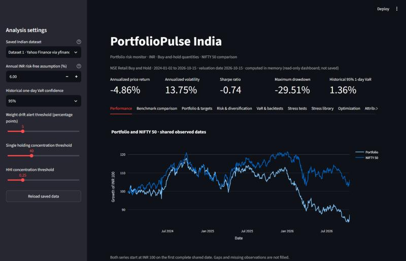
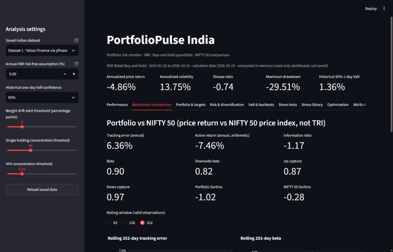
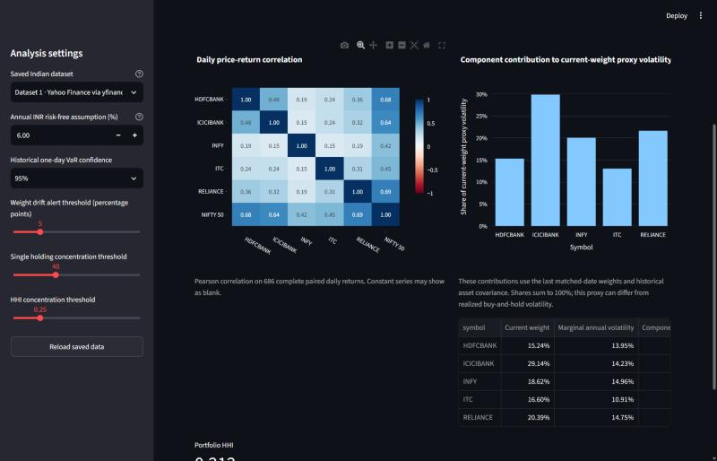
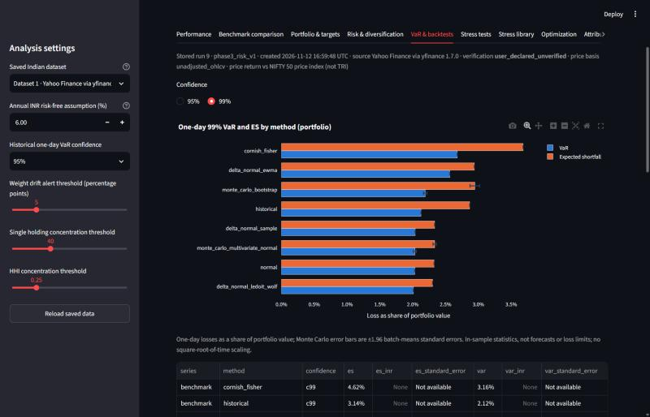
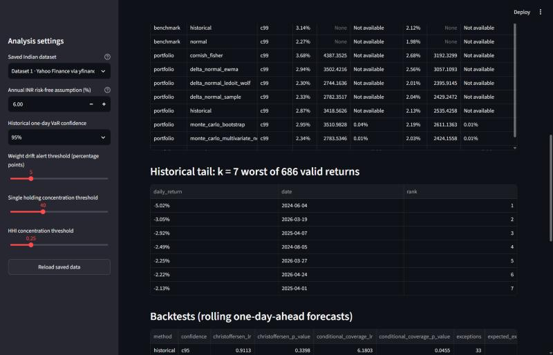
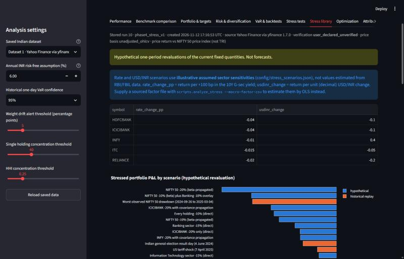
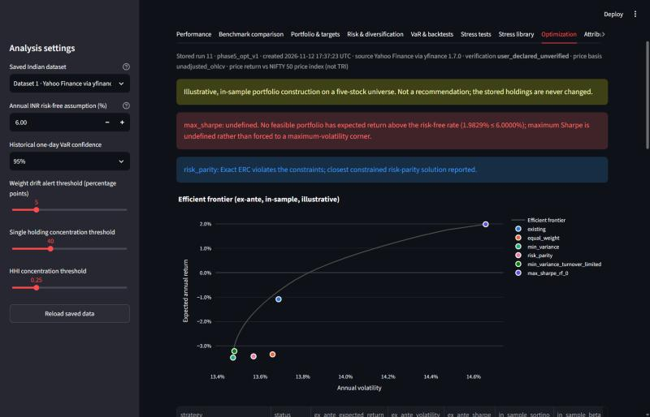
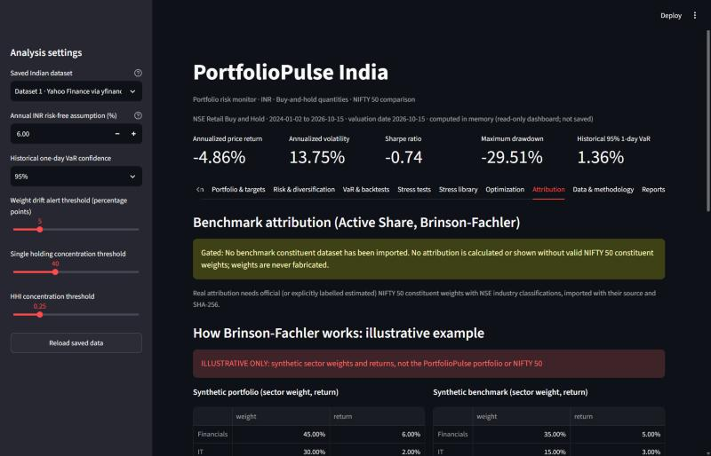
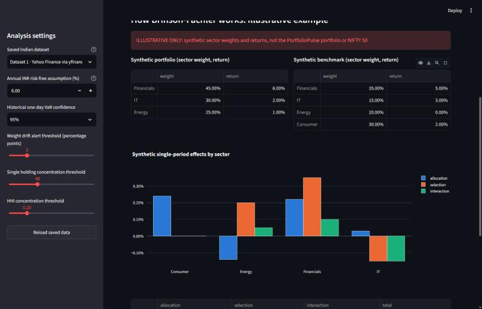
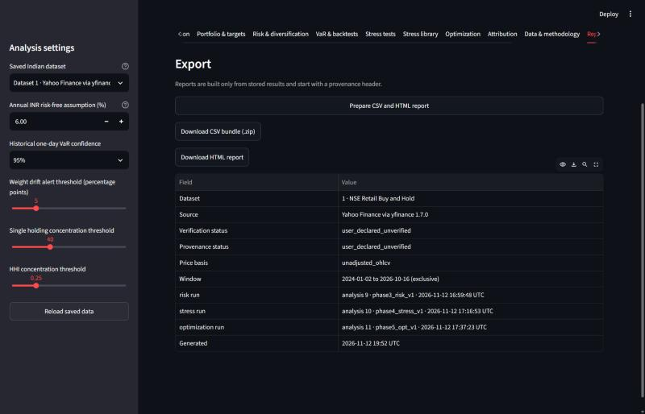

# PortfolioPulse India


A portfolio analytics and risk management application for a small portfolio of Indian stocks, written in Python with pandas, NumPy, SciPy, SQLite and Streamlit.

> **Educational project.** It is not investment advice, a trading system or a forecasting tool. The numbers below come from unverified market data and are shown only to demonstrate the methods.

## 1. Project overview

PortfolioPulse tracks a buy-and-hold portfolio of five NSE stocks (RELIANCE, HDFCBANK, INFY, ICICIBANK, ITC) and compares it with the NIFTY 50. It measures return and risk, estimates one-day Value at Risk with several methods and backtests them, runs stress scenarios, and compares alternative allocations under constraints. Results are stored in SQLite and shown in a read-only Streamlit dashboard. Every result shows where its data came from and whether that data has been verified.

Two modelling conventions apply throughout:
- **Buy and hold:** share quantities stay fixed (`config/instruments.json`), so portfolio weights drift with prices.
- **Benchmark:** the NIFTY 50 **price index**, not the total-return index. All returns are close-to-close price returns; dividends are not included.

## 2. Problem statement and objective

A portfolio analyst usually needs to answer four questions:

1. How did the portfolio perform against its benchmark?
2. How much could it lose on a bad day, and does the risk model hold up when tested?
3. What happens in a market, sector, interest-rate or currency shock?
4. Would a different allocation have been better once constraints and trading costs are included?

The objective was to answer each question with methods that can be checked by hand, to keep every number traceable to its data source, and to say clearly when the data cannot support an answer rather than fill the gap.

## 3. Main features

- **Data handling:** CSV and Angel One SmartAPI ingestion; validation without forward-filling; immutable dataset snapshots; versioned database migrations; a provenance record for each dataset; tools to verify the price basis against NSE corporate actions.
- **Performance and benchmark:** cumulative and annualized return, volatility, Sharpe, Sortino, drawdown with duration and recovery, tracking error, information ratio, beta, downside beta, up/down capture, rolling statistics.
- **Risk:** historical, normal, Cornish-Fisher and Monte Carlo VaR and Expected Shortfall; Kupiec and Christoffersen backtests; sample, Ledoit-Wolf and EWMA covariance; component VaR and risk contributions.
- **Stress testing:** market shocks spread through betas, sector and stock shocks, correlation-based propagation, interest-rate and USD/INR sensitivities, and replays of historical events.
- **Optimization:** minimum variance, maximum Sharpe, risk parity, efficient frontier; weight, sector and turnover limits; Indian trading costs; whole-share allocation; walk-forward testing.
- **Attribution:** Brinson-Fachler with Carino linking, and Active Share. Shown only as a **synthetic example**, because real benchmark weights are not available.
- **Dashboard and reports:** 11 tabs, CSV and HTML exports, automated tests on GitHub Actions.

## 4. Technology stack

| Purpose | Tools |
|---|---|
| Language | Python 3.12 |
| Analysis | pandas 3.0, NumPy 2.5, SciPy 1.18 (optimization and statistics) |
| Storage | SQLite (Python standard library) |
| Dashboard | Streamlit 1.66, Plotly 7.1 |
| Market data | Angel One SmartAPI (`smartapi-python`), source-labelled CSV files |
| Testing | pytest, Streamlit AppTest, GitHub Actions (Windows, Python 3.12) |

Exact versions are pinned in [requirements.txt](requirements.txt) and [requirements-dev.txt](requirements-dev.txt).

## 5. System architecture

```text
CSV files / Angel One API / NSE reference files
          │  validation (no forward-fill) and provenance labels
          ▼
SQLite database: datasets, daily prices, holding snapshots, stored analysis runs
          ▲ written only by command-line scripts      │ read-only connection
          │                                            ▼
analysis scripts ─► calculation modules        Streamlit dashboard + reports
(risk, stress, optimization)  (no database access)
```

Design decisions:
- **Calculations are pure functions.** They have no database or UI code, so they are easy to test with small hand-worked examples.
- **Only the command-line scripts write results.** Each stored run records its method settings and an engine version, and running the same analysis twice reuses the existing result instead of duplicating it.
- **The dashboard opens the database read-only.** Viewing results cannot change them.
- **Corrections create new dataset versions.** Existing data is never edited.

More detail: [docs/ARCHITECTURE_GUIDE.md](docs/ARCHITECTURE_GUIDE.md) and [docs/CODE_WALKTHROUGH.md](docs/CODE_WALKTHROUGH.md).

## 6. Financial methodologies used

| Topic | Method |
|---|---|
| Portfolio return | V_t = Σ qᵢPᵢ,t and r_t = V_t / V_{t−1} − 1, using only dates where every stock and the index have a price; 252 trading days a year |
| Sharpe and Sortino | Sample standard deviation × √252; daily risk-free rate from an assumed 6% annual rate (not a live RBI rate) |
| Historical VaR / ES | The k = ⌈(1 − c)N⌉ worst daily returns; ES is their average |
| Parametric and Cornish-Fisher VaR | −(μ + zσ), with z adjusted for skewness and kurtosis in the Cornish-Fisher version |
| Monte Carlo VaR | Seeded simulation (multivariate normal or bootstrap) revalued at fixed share quantities, with a reported standard error |
| Backtesting | One-day-ahead forecasts using only past data; Kupiec and Christoffersen likelihood-ratio tests |
| Risk contributions | Euler allocation: RCᵢ = wᵢ(Σw)ᵢ / σ_p, which adds up to total volatility |
| Brinson-Fachler | Allocation (w_p − w_b)(R_b,s − R_b), selection w_b(R_p,s − R_b,s), interaction (w_p − w_b)(R_p,s − R_b,s); Carino linking across periods |
| Optimization | SciPy SLSQP with every result re-checked against the constraints; Ledoit-Wolf covariance; log-barrier risk parity |

Each method is explained with formulas, code locations and worked examples in [docs/FINANCIAL_CONCEPTS_GUIDE.md](docs/FINANCIAL_CONCEPTS_GUIDE.md). [docs/FINANCIAL_METHODOLOGY_AUDIT.md](docs/FINANCIAL_METHODOLOGY_AUDIT.md) records how each one was checked against hand calculations.

## 7. Dashboard screenshots

The screenshots show the dashboard running on dataset 1 (Yahoo Finance data, unverified).

| | |
|---|---|
|  Performance against NIFTY 50 |  Benchmark statistics |
|  Correlations and risk contributions |  VaR and ES by method |
|  Worst days and backtest results |  Stress scenarios and labelled assumptions |
|  Efficient frontier and optimizer status |  Attribution disabled without benchmark weights |
|  Brinson-Fachler on **synthetic** data |  Report export with data provenance |

## 8. Example results

Dataset 1, valued on 2026-10-15 at ₹119,199. In-sample results on unverified data.

| Measure | Portfolio | NIFTY 50 |
|---|---|---|
| Annualized price return | −4.86% | +2.21% |
| Annualized volatility | 13.75% | 13.59% |
| Sharpe ratio (assumed 6% risk-free rate) | −0.74 | −0.20 |
| Beta / tracking error / information ratio | 0.90 / 6.36% / −1.17 | — |
| Maximum drawdown | −29.5% (not yet recovered) | −15.8% |

**Risk.** One-day 99% VaR:
- historical: 2.13% (₹2,535), based on the 7 worst of 686 days;
- normal: 2.03%;
- Cornish-Fisher: 2.68% (higher because the returns have fat tails);
- Monte Carlo: 2.03%.

**VaR backtest.** The historical 95% VaR **fails** the Kupiec test, with 33 exceptions where 21.8 were expected (p = 0.022).
- **Cause:** the exceptions cluster in the volatile early months of 2026, and an equal-weighted 250-day window adjusts too slowly.
- **Alternative tested:** an age-weighted historical VaR passes on the same dates. It was not made the default, because it was chosen after looking at this one sample.

The full analysis is in [docs/VAR_BACKTEST_DIAGNOSTICS.md](docs/VAR_BACKTEST_DIAGNOSTICS.md).

**Stress scenarios (hypothetical):**

| Scenario | Impact |
|---|---|
| NIFTY 50 −20%, spread through betas | −18.4% |
| NIFTY 50 −10% plus Banking −10% | −13.6% |
| Replay of the worst NIFTY drawdown in the data (Sep 2024 – Mar 2025) | −13.5% |
| ICICIBANK −20%: alone vs with correlated moves | −5.8% vs −10.5% |

**Optimization.**
- Under 5–35% stock limits and a 40% Banking cap, minimum variance lowers expected volatility only from 13.69% to 13.47%.
- **Maximum Sharpe is undefined**, because no allowed portfolio has an expected return above the 6% risk-free assumption. The app reports this instead of returning a meaningless answer.
- Expected returns estimated from about 2.7 years of data are very noisy (standard errors of 12–16% a year). The optimized weights are illustrative, not recommendations.

**Attribution.** The Brinson-Fachler formulas are implemented and tested. Real attribution needs NIFTY 50 constituent weights, which I don't have, so the dashboard shows a clearly marked synthetic example instead. Benchmark weights are never made up.

## 9. Data sources and limitations

| Data | Status |
|---|---|
| Dataset 1: Yahoo Finance CSV, 2024-01-02 to 2026-10-15 | User-declared and **unverified**. Its price basis is unconfirmed: the evidence suggests split/bonus-adjusted prices. Used for all results above |
| Dataset 2: Angel One SmartAPI, 15 days | Fetched live, but only 10 returns: used for checks, not for statistics |
| NIFTY 50 reference sample | Ten closes from NSE Indices match dataset 1 within 0.01 points. This covers only those ten dates |
| `data/demo/prices.csv` | Synthetic data for the demo path and tests |

The market data and the database are **not** included in this repository. Loading formats and the NSE spot check are described in [docs/DATA_SOURCES.md](docs/DATA_SOURCES.md).

**Limitations:**
- **Price returns only.** No dividends, and the benchmark is the price index, not the total-return index.
- **Short, narrow sample.** About 2.7 years, five stocks, one market regime. All statistics are in-sample, there is no claim of broad diversification, and the stock selection carries survivorship bias.
- **Assumed inputs.** The rate and USD/INR sensitivities are illustrative assumptions, and the trading-cost rates need checking against a broker's contract note.
- **Unavailable scenarios.** The COVID-2020 and 2022 scenarios are reported as unavailable because the data starts in 2024.
- **Missing external data.** Several improvements need official data that isn't in the project: NSE corporate actions, NIFTY 50 constituent weights, RBI/FBIL interest rates, USD/INR history, and ITC Hotels demerger values. See [docs/DATA_DEPENDENCIES.md](docs/DATA_DEPENDENCIES.md).

## 10. Installation and setup (Windows)

Install Python 3.12, then from the project folder:

```powershell
python -m venv .venv
.\.venv\Scripts\python.exe -m pip install -r requirements-dev.txt
.\.venv\Scripts\python.exe -m pip check
```

Load market data, as described in [docs/DATA_SOURCES.md](docs/DATA_SOURCES.md). For a source-labelled CSV:

```powershell
.\.venv\Scripts\python.exe -m scripts.ingest_phase3 --source sourced --input data\incoming\prices.csv --start 2024-01-02 --end 2026-10-16
```

Run the three analyses that the dashboard displays. Replace `1` with your dataset ID.

```powershell
.\.venv\Scripts\python.exe -m scripts.analyze_risk --dataset-id 1
.\.venv\Scripts\python.exe -m scripts.analyze_stress --dataset-id 1
.\.venv\Scripts\python.exe -m scripts.analyze_optimization --dataset-id 1
```

Settings live in `config/` (portfolio, scenarios, optimization constraints and costs). Angel One credentials go only in a local `.env` file, copied from [.env.example](.env.example).

## 11. How to run the application

```powershell
.\.venv\Scripts\python.exe -m streamlit run app.py
```

Then open http://localhost:8501. The dashboard opens the most recent dataset with saved results. A suggested walkthrough is in [docs/PROJECT_DEMO.md](docs/PROJECT_DEMO.md).

**Common problems:**
- **"No real Indian market dataset":** load data first.
- **Empty risk, stress or optimization tabs:** run the three analysis commands above.
- **"needs at least 252":** the dataset is too short for optimization.
- **Port already in use:** add `--server.port 8502`.

## 12. Running tests

```powershell
.\.venv\Scripts\python.exe -m pytest -q -p no:cacheprovider
```

- **Latest result:** 286 tests and 71 subtests pass, both locally and on GitHub Actions ([workflow](.github/workflows/tests.yml)).
- **What they cover:** many financial tests compare the code with values worked out by hand. The others use temporary databases and synthetic data, so no market data or credentials are needed.

Two read-only checks can be run on your own database:

```powershell
.\.venv\Scripts\python.exe -m scripts.audit_consistency --dataset-id 1
.\.venv\Scripts\python.exe -m scripts.var_diagnostics --dataset-id 1
```

---

*Developed as a student project with the help of an AI coding assistant (Claude Code). The design choices, tests and documented limitations are described in the `docs/` folder.*
